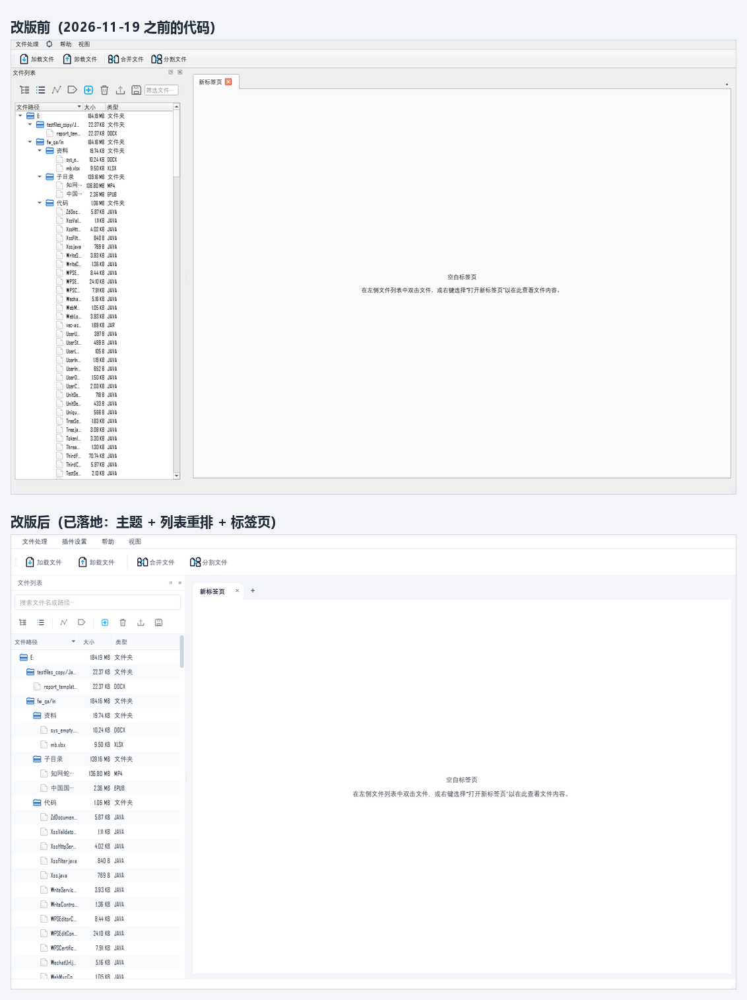
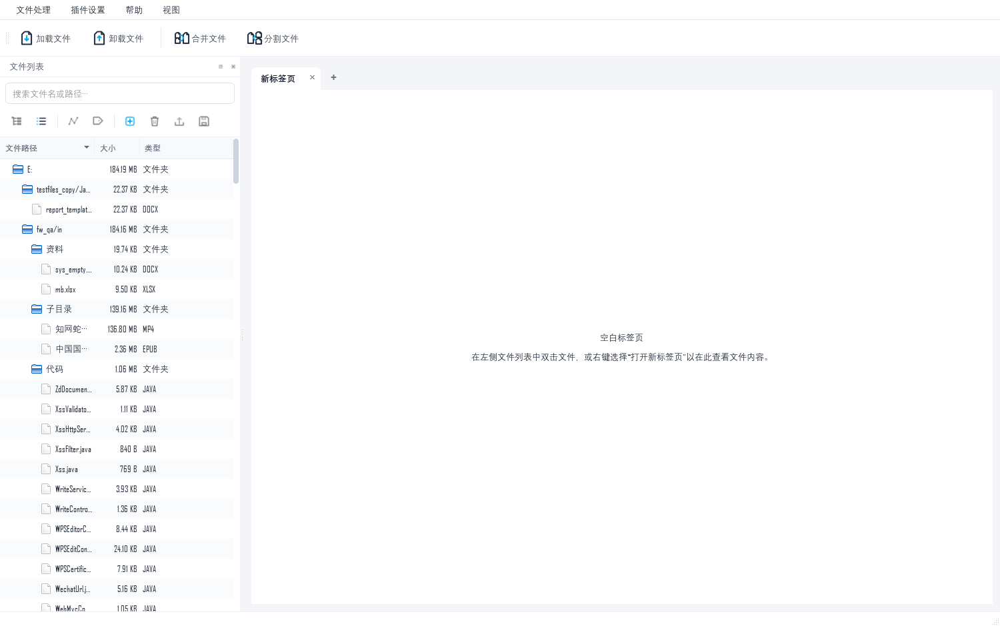
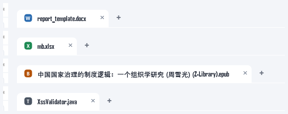
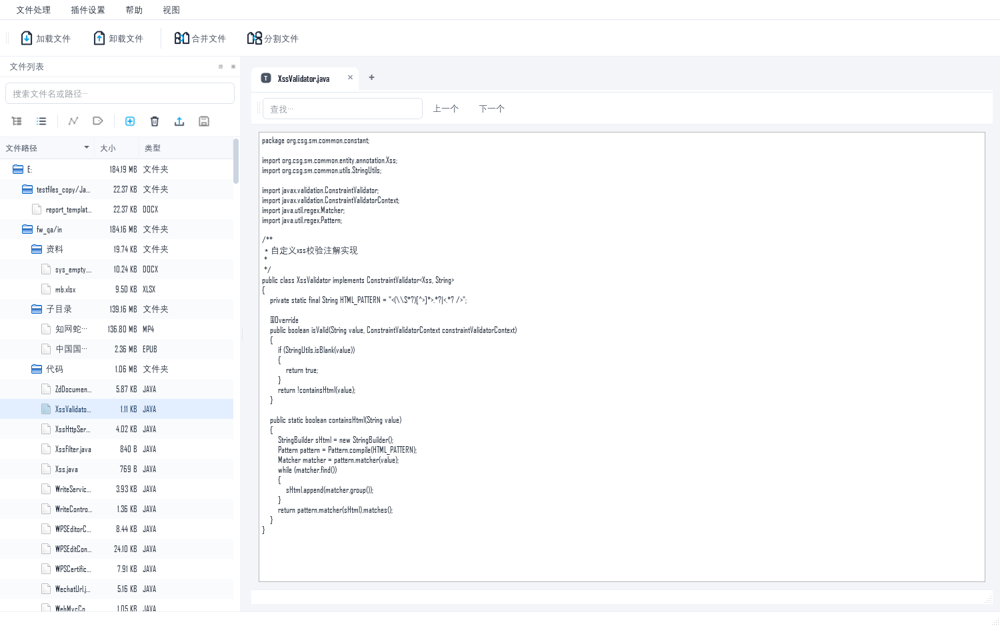
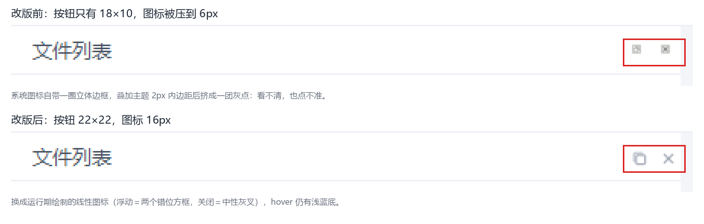
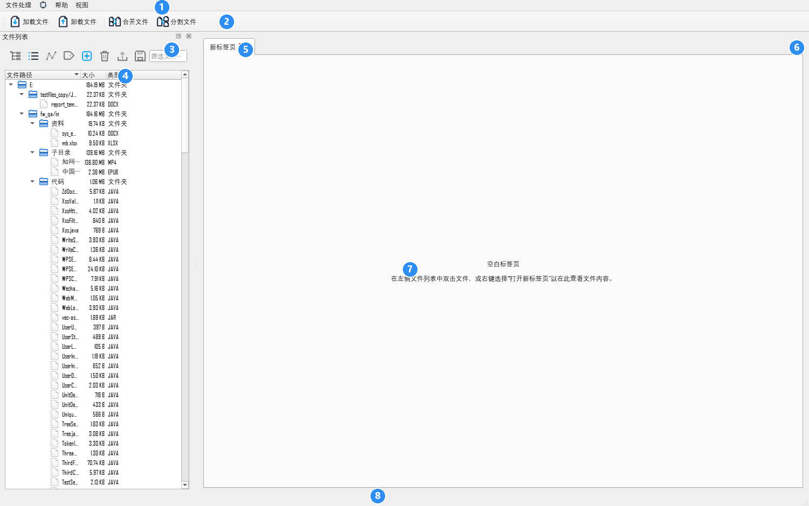
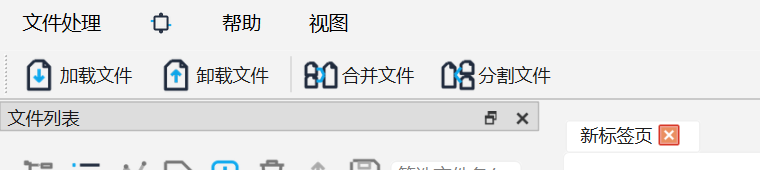
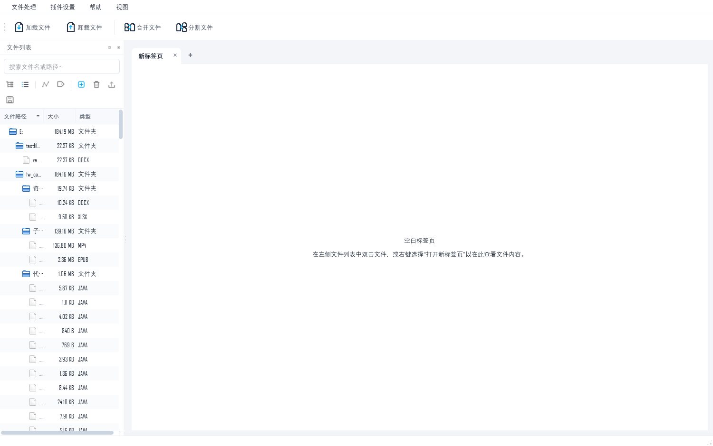
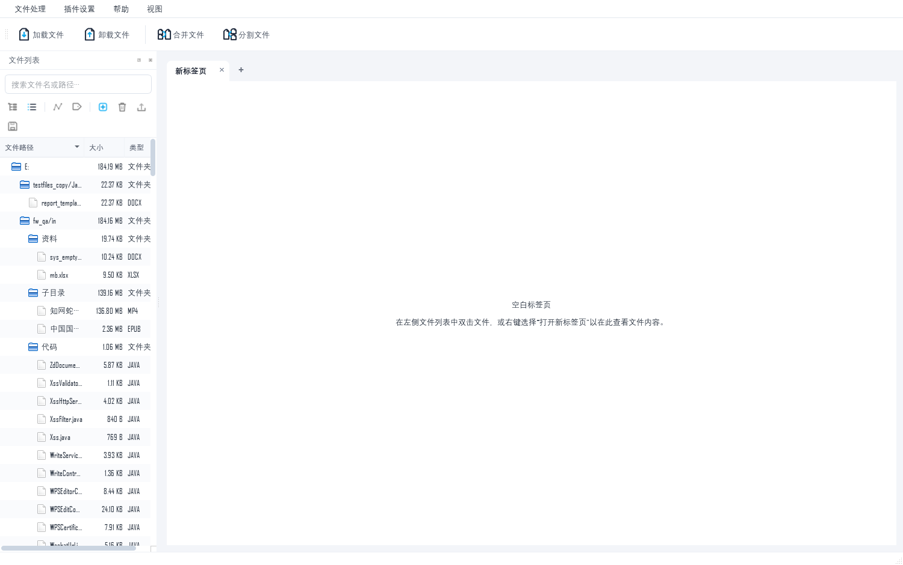
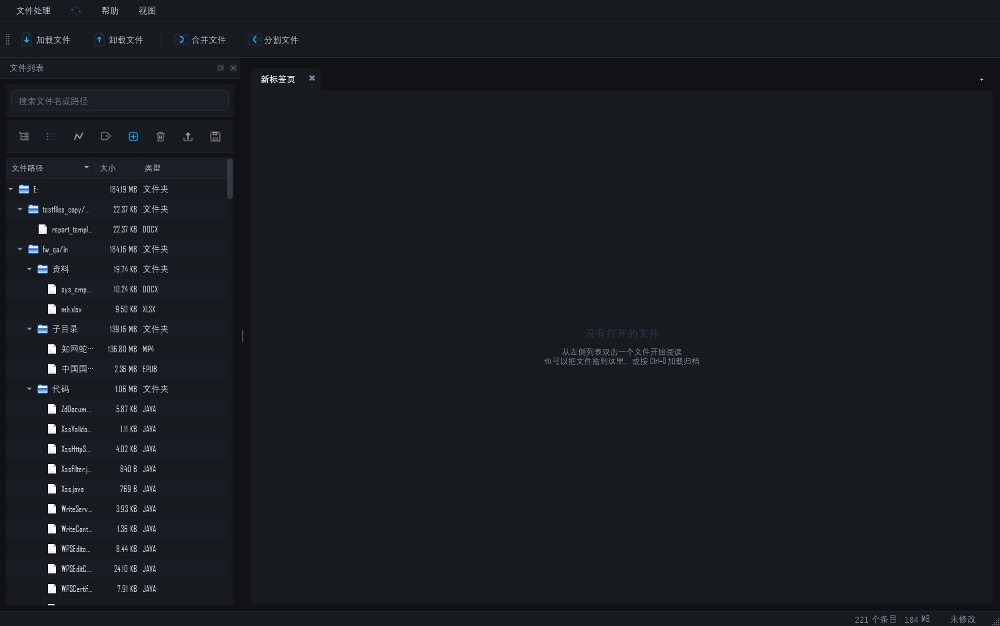

# FileWrapper 界面优化建议（P0 已落地）

> 评审对象：当前工作区代码（2026-11-19，Qt 6.9.3 / MinGW）。
> 文中的截图都是**用真实源码编译出来的 MainWindow** 离屏渲染的，不是手工画的：改版前用改动前的源码，改版后用本次改动后的源码（含真实插件）。
> 文中出现的仓库内路径（如 `FileWrapper/mainwindow.cpp:309`）均相对**仓库根目录**；行号是 2026-11-19 评审时的快照，后续改动后请以符号名（函数/变量）为准。

---

## 本次已落地（P0-0 ~ P0-3，2026-11-19）

P0 的四条已经改完并编译验证，对比图如下（上：改版前；下：改版后，真实运行渲染）：



| 项 | 状态 | 落点 |
|----|------|------|
| P0-0 菜单栏图标挤掉文字 | ✅ | `FileWrapper/mainwindow.cpp` 去掉 `ui->menu_2->setIcon(...)`；顺带给主工具栏补 `windowTitle`（见下） |
| P0-1 主题层（Fusion + 字体 + QSS + 中文翻译） | ✅ | `FileWrapper/main.cpp`、`resources/theme/light.qss`、`resources/resources.qrc`（前缀 `/theme`）、`deploy/plugin-deps.manifest`（部署 qtbase_zh_CN.qm） |
| P0-2 文件列表：搜索行 + 图标行（窄栏自动换行） | ✅ | `initWidgetFilePath()`：搜索框独立一行；8 个动作改 18px 图标 + 分隔线分组；`FwActionBar`（`FwFlowLayout`）替换 QToolBar，窄栏排满自动换行，不再折进 `»` |
| P0-3 标签页：类型角标 / 就近「+」/ 中键关闭 / Ctrl+W / 拖动排序 / 脏标记 | ✅ | `tabIconForFile()`、`updateNewTabButton()`、`eventFilter()` 中的标签栏分支、`updateWindowTitle()` |

改版后的主界面：



标签页类型角标（Word / Excel / 电子书 / 代码），右侧紧跟「+」，关闭按钮换成中性灰叉：



打开一个文件后的实际效果（文本阅读器继承了全局主题）：



标准按钮已中文化（`保存 / 丢弃 / 取消`，主按钮用品牌色）：


**验证方式**：用真实 `MainWindow` + 真实插件（`qa.dat` 归档）离屏渲染；另用正式 exe 做过启动冒烟。

**本轮没有动的**（仍按下文 P1/P2 排期）：空状态改版、文件列表按类型显示图标、状态栏常驻信息、阅读器工具栏统一、对话框改版、深色模式。

### 顺手修掉的空白菜单项

在工具栏/停靠区右键会弹出 QMainWindow 自动生成的「显示/隐藏」菜单，其中工具栏那一项的**文字取自 `QToolBar::windowTitle()`**；`.ui` 里没设，就变成一个只有勾选、没有文字的空白项。已补 `ui->mainToolBar->setWindowTitle(tr("主工具栏"))`，并把「主工具栏」也加进菜单栏的「视图」菜单（以前只有「文件列表」）：


> 注意：各个插件阅读器（PDF / 文本 / 媒体…）内部也有自己的 QToolBar，它们的右键菜单同样会缺文字；要彻底解决需在每个插件的 `mainwindow.ui` 里补 `windowTitle`，属于 P1 清理项。

### 停靠面板标题栏的「浮动 / 关闭」按钮太小（反馈，已修）

左侧「文件列表」标题栏右上角的浮动 / 关闭按钮，实测只有 **18×10**、图标被压到 6px：Fusion 给的标准图标自身带一圈立体边框，主题又给这两颗按钮 `padding: 2px`，两下一叠就成了一团灰点，看不清也点不准（高缩放下更糊）。

改成：按钮固定 **22×22**、图标 **16px**，并换成运行期绘制的线性图标（浮动＝两个错位方框，关闭＝中性灰叉，取色与标签页关闭按钮一致）；标题行高度不变，hover 仍是主题里的浅蓝底。



落点：`FileWrapper/mainwindow.cpp` 的 `makeDockTitleIcon()` 与 `MainWindow::polishDockTitleButtons()`——后者在构造函数里对**所有**停靠窗统一调用，以后新增停靠窗不用再改一遍；`resources/theme/light.qss` 只补了一句注释说明尺寸为什么不走 QSS（`QDockWidgetTitleButton::sizeHint()` 会把 padding 算进去，两边一起调容易互相打架）。
按钮放大后实测点击行为不变：点「浮动」面板脱离成独立窗口，点「关闭」面板隐藏（仍可从「视图」菜单找回）。

---

## 0. 结论先行（改版前的判断）

改版前的界面属于「功能齐、观感散」：控件本身都是对的，但**没有任何统一样式层**，于是出现三个显而易见的问题：

1. **零样式、零字体、零翻译**：`main.cpp` 只有 13 行，界面完全由系统默认风格渲染；标准按钮还是英文 `OK / Cancel / Save / Discard`（见仓库根目录 `.workbuddy/tmp/qa-shots/` 下的 `170-close-prompt.png`、`91-plugin-manager.png`）。
2. **信息挤在一行**：左侧「文件列表」把 8 个文字按钮 + 搜索框塞进一条工具栏，窄一点就被折进 `»` 溢出菜单（见下方 ①③）。
3. **三套视觉并存**：主窗口是系统浅色风；媒体播放器另写了一套深色（`#1b1b1b` + `#00bcf2` + emoji 图标，`Plugins/PluginMedia/mainwindow.ui:16-29`）；其余阅读器窗口是纯默认白底。三者放到同一个标签栏里，割裂感很强。

按投入产出排序，**先做下面这几件（约 1 天），观感能立刻从"演示程序"变成"正经工具"**（P0 已全部落地，见文首）：

| # | 事项 | 工作量 | 收益 |
|---|------|--------|------|
| P0-0 | 修掉菜单栏图标挤掉文字 | 10 分钟 | 立刻少一个显眼的破绽 |
| P0-1 | 引入主题层：Fusion + 字体 + QSS + 中文翻译 | 0.5 天 | 全局统一，一次性解决"散" |
| P0-2 | 左侧列表：搜索行 + 图标行（去掉 8 个文字按钮） | 0.5 天 | 解决拥挤与溢出 |
| P0-3 | 标签页：类型图标 + 就近"+" + 中键关闭 + 脏标记 | 0.5 天 | 多标签从"能用"到"顺手" |

---

## 1. 现状盘点（带标注）



| 标号 | 现象 | 证据 |
|------|------|------|
| ① | 菜单栏：`插件设置` 只剩一个图标、**文字被挤没了**（给 `QMenu` 设图标的经典坑）；另三个菜单都是纯文字，只有它是图标 | `mainwindow.cpp:173`（`ui->menu_2->setIcon(...)`），实拍见 `shots/menu-icon-bug.png` |
| ② | 主工具栏只有 4 个动作，图标+文字横排，占一整条高度 | `mainwindow.cpp:383-389` |
| ③ | 左侧 8 个动作在 340px 宽度下只显示 4 个，其余和搜索框一起被折进 `»` | `mainwindow.cpp:309-349`，实测见 `shots/before.png` |
| ④ | 列宽固定：文件名被截成 `testfiles_copy/...`、`中国...`；文件图标是系统通用空白页，看不出类型 | `mainwindow.cpp:2341-2342`（`SP_DirIcon` / `SP_FileIcon`） |
| ⑤ | 标签页只有文件名 + 一个高饱和红色关闭块，没有类型图标，没有"未保存"标记 | `mainwindow.cpp:1001`、`:1036` |
| ⑥ | `+` 用 `setCornerWidget(…, Qt::TopRightCorner)` 放到了窗口最右侧，离标签页 1000px | `mainwindow.cpp:424-430` |
| ⑦ | 空标签页只有两行居中小字，没有引导入口 | `mainwindow.cpp:446` |
| ⑧ | 状态栏完全空白，不承载条目数 / 总大小 / 保存状态 | 全文件仅在临时提示时 `showMessage()` |

另外两处不在主窗口里，但同样是"观感重灾区"：

- **关于框**：`dlgabout.ui` 里把 `SimSun 9pt` 硬编码进了 QTextEdit 的 HTML（第 26 行），实际显示为老宋体，且 400×300 的框里大片空白。
- **导出框**：`dlgoutputfile.ui` 全部用绝对坐标摆控件（`<x>50</x><y>17</y>`），一旦系统字体变化或 125%/150% 缩放，文字就会挤出按钮。

---

## 2. P0：1 天内能做完，观感提升最大

### P0-0 顺手修掉：菜单栏图标把文字挤没（10 分钟）✅

> 已落地：删掉 `ui->menu_2->setIcon(...)`，菜单栏四个菜单现在都是纯文字。

150% DPI 实拍（原生渲染，不是示意图）：



`mainwindow.cpp:173` 给 `ui->menu_2`（插件设置）设了图标，但 `QMenuBar` 算项宽时只按文字算、绘制时却把图标画在文字的位置，结果 `插件设置` 只剩一个图标。两种修法：

- **删掉这行**（Windows 的菜单栏本来就不画菜单级图标，`文件处理` / `帮助` 现在也没有）；
- 或只给**菜单项**（QAction）设图标——那是正常渲染的。

建议顺手把「插件诊断 / 插件管理 / 重新加载插件 / 支持的格式」的图标保留在**菜单项**上，视觉信息不丢。

---

### P0-1 引入统一的主题层（QSS + Fusion + 字体 + 中文翻译）✅

> 已落地：`FileWrapper/main.cpp` 现为 `applyTheme()` + `installChineseTranslator()`，
> 样式表在 `resources/theme/light.qss`（qrc 前缀 `/theme`）；
> 翻译文件由 `deploy/deploy-deps.ps1` 的 `qt-trans` 源随构建拷到 exe 同级 `translations/`。
> 运行期优先找 exe 同级目录，开发机回落到 Qt 安装目录。

**为什么**：现在没有任何样式入口，改一处颜色要动几十个控件；而项目里已经有 164 个 PNG 图标（20/24/32/40/48/64 六个尺寸，`resources/resources.qrc`），却没有被界面语言统一使用。

**怎么做**（`FileWrapper/main.cpp`，当前只有 13 行）：

```cpp
#include <QApplication>
#include <QFile>
#include <QFont>
#include <QLibraryInfo>
#include <QStyleFactory>
#include <QTranslator>
#include "mainwindow.h"
#include "icons.h"

int main(int argc, char *argv[])
{
    QApplication a(argc, argv);

    // 1) Fusion：跨 Windows 版本表现一致，QSS 也好写
    a.setStyle(QStyleFactory::create(QStringLiteral("Fusion")));

    // 2) 字体：中文界面 + 4K/125% 缩放下更清楚
    QFont f(QStringLiteral("Microsoft YaHei UI"));
    f.setPointSizeF(10.0);
    a.setFont(f);

    // 3) 主题：resources/theme/light.qss（qrc 前缀 /theme）
    QFile qss(QStringLiteral(":/theme/light.qss"));
    if (qss.open(QIODevice::ReadOnly))
        a.setStyleSheet(QString::fromUtf8(qss.readAll()));

    // 4) Qt 自带控件的中文化：OK/Cancel/Save/Discard → 确定/取消/保存/放弃
    auto *tr = new QTranslator(&a);
    if (tr->load(QStringLiteral("qtbase_zh_CN"),
                 QLibraryInfo::path(QLibraryInfo::TranslationsPath)))
        a.installTranslator(tr);

    a.setWindowIcon(FwIcons::get(QStringLiteral("appicon")));
    MainWindow w;
    w.show();
    return a.exec();
}
```

**注意**：`qtbase_zh_CN.qm` 在 Qt 安装目录的 `translations/` 下。已落地版本在 `deploy/deploy-deps.ps1` 里新增了 `qt-trans` 源类型，构建末尾自动拷到 `exe/translations/`，不需要手工部署。

**顺带解决的**：`QMessageBox` 里手写的英文按钮（`Save / Discard / Cancel`，见 `170-close-prompt.png`）也会一起中文化；自定义按钮文案统一写成中文。

---

### P0-2 左侧文件列表：从「一行 8 个按钮」改成「搜索行 + 图标行」✅

> 已落地：`initWidgetFilePath()` 重写为「搜索行 / 图标工具条 / 文件树」三段式；
> 8 个动作改为 18px 图标 + 中文 tooltip + 两条分隔线分组；搜索框 `minimumWidth(160)` 且不再限宽。
> 工具条用 `FwActionBar`（自绘 `FwFlowLayout` 流式布局）替代 `QToolBar`：**面板变窄时按钮换行，不再被收进 `»` 消失**。
> 「文件路径」列改为自己管理宽度（`adjustPathColumnWidth()`）：**不低于 140px**，面板再窄也不会被「大小/类型」两列挤成一条缝，放不下时由横向滚动条兜底。
> 同时打开斑马纹、30px 行高、14px 缩进（`setUniformRowHeights` 在填充模型前设置）。

**现状**（`mainwindow.cpp:309-349`）：8 个 `QAction` 全是**纯文字**，加上一个 `setMaximumWidth(200)` 的搜索框，一起铺在一行里。实测 340px 宽时只放得下 4 个动作 + 被压扁的搜索框，其余全部进 `»`；在 4K 截图里搜索框更是只剩 ~90px。

**建议布局**：

```
┌─ 文件列表 ────────────────────────────┐
│ [🔍 搜索文件名或路径…              ] │   ← 独占一行，宽度拉满
│ [树][平铺] │ [路径][名称] │ [+][🗑][⤓][💾] │   ← 18px 图标 + tooltip
├──────────────────────────────────────┤
│ 文件路径            大小      类型    │
```

要点：

1. **搜索框单独一行**：`minimumWidth(160)` + 不设 `maximumWidth`，`placeholderText("搜索文件名或路径…")`，保留 `setClearButtonEnabled(true)`。
2. **8 个动作改图标**：资源里已经有 20~64px 全尺寸，`FwIcons::get()` 会按尺寸取（`icons.h:9-15`）。给工具栏设 `setToolButtonStyle(Qt::ToolButtonIconOnly)` + `setIconSize(QSize(18,18))` + 中文 `toolTip`，一行放得下。
3. **按语义分组**，组间加分隔线：视图（树/平铺）｜显示（路径/名称）｜文件（添加/删除/导出/保存）。
4. **窄栏要换行，不能折进溢出菜单**：`QToolBar` 放不下时会把动作收进 `»`，按钮直接消失（第一版就踩了这个坑，见下方）。已改成 `FwActionBar`（自绘 `FwFlowLayout` 流式布局）：排满自动换行，8 个按钮在 190px 宽下也全都在。
5. **建议补 16px 图标**：`FwIcons::get()` 目前从 20px 起，Windows 100% 缩放下工具栏标准尺寸是 16px，会走降采样、略糊。加一套 `*_16.png` 即可。
6. 更激进一点：把「显示路径 / 显示名称」合成一个下拉按钮，把「添加文件 / 添加目录」合并成一个带菜单的按钮，动作从 8 个降到 5 个，窄栏连换行都不需要。

面板拖窄后的实际效果（260px：7 个图标 + 第二行 1 个，没有按钮消失）：



**为什么放 P0**：这一条是用户每天要点十几次的区域，拥挤感最直接。

---

### P0-3 标签页升级 ✅

> 已落地：`tabIconForFile()` 按后缀生成 9 类彩色角标（运行时 QPainter 绘制，无需图片资源）；
> 就近「+」用叠在标签栏上的 `QToolButton` 实现（`updateNewTabButton()`，标签增删/缩放后重排）；
> 中键关闭在 `eventFilter()` 的标签栏分支；`Ctrl+W / Ctrl+T / Ctrl+Tab / Ctrl+Shift+Tab / Ctrl+F` 挂在窗口上；
> 标签可拖动排序；窗口标题带 `*`（`updateWindowTitle()`）。
> 顺带发现并修掉：`activateTab()` 里 `removeTab + insertTab` 会把图标清掉，已补 `setTabIcon`。

**现状**：`addTab(new QWidget(), info.sFileName)`（`mainwindow.cpp:1001`），只有文字；关闭按钮用系统默认的红色方块；"+" 放在窗口最右侧（`:430`）；`setMovable(false)`（`:417`）。

**建议**：

| 改进 | 做法 | 收益 |
|------|------|------|
| 类型图标 | `addTab(icon, text)` / `setTabIcon()`；图标按后缀分 8 类：文档、表格、幻灯片、PDF、图片、音视频、电子书、代码 | 一眼分辨打开的是什么 |
| 关闭按钮 | QSS `QTabBar::close-button` 换中性灰叉（`resources/theme/icons/close_light.xpm`，文本资源） | 去掉刺眼的红块 |
| "新标签页"按钮 | 换自定义 `QTabBar`：在最后一个 tab 右侧画一个 "+"；或把 `+` 作为首个固定 tab | 鼠标行程从 1000px 降到 50px |
| 关闭/切换 | 中键关闭（`QTabBar::tabBarClicked` + `Qt::MiddleButton`）、`Ctrl+W` 关闭、`Ctrl+Tab` 切换 | 桌面软件基本操作 |
| 顺序 | `setMovable(true)`，允许拖动排序 | 多文档场景常用 |
| 脏标记 | 归档有未保存改动时窗口标题加 `*`，当前标签文字前加 `●` | 避免误关丢改动 |

类型图标可以先不做美术：用品牌色圆角方块 + 后缀首字母（`P`/`W`/`X`/`M`）也能立刻见效，后面再换正式图标。

---

## 3. P1：把「能用」做成「好用」

### P1-1 空状态（Empty State）

现状是一行居中文字（`mainwindow.cpp:446`）。建议换成"图标 + 主标题 + 两条动作 + 最近文件"：

```
        [ 文件图标 64px ]

        没有打开的文件
   从左侧列表双击文件开始阅读
   也可以把文件拖到这里，或按 Ctrl+O 加载归档

   [ 加载归档… ]   [ 支持的格式… ]
```

要点：主标题 15-16px/600 字重、说明 12px 弱化色、按钮用主色描边；窗口尺寸变化时整体居中，不要随富余空间跳到偏上。

### P1-2 文件列表的视觉细节

| 项 | 现状 | 建议 |
|----|------|------|
| 文件图标 | `SP_FileIcon` 通用空白页（`mainwindow.cpp:2341`） | 按后缀给 16px 彩色图标；文件夹用带"开口"的样式，和文件区分 |
| 列宽 | ~~第 0 列 `Stretch`，另外两列 `ResizeToContents`~~ ✅ 已改 | 「文件路径」列改由 `adjustPathColumnWidth()` 管理：宽度 = 视口 − 大小/类型，且 **≥ 140px**；不够就出横向滚动条。见下方截图。大小列仍建议右对齐 + 等宽数字 |
| 行高 | 默认 ~20px | ✅ 已落地 30px（QSS `QTreeView::item { height: 30px; }`） |
| 斑马纹 | 无 | ✅ 已落地 `setAlternatingRowColors(true)` + `alternate-background-color` |
| 缩进 | 默认 ~20px/级 | ✅ 已落地 14px/级，深层目录不至于把文件名挤没 |
| 悬浮/选中 | 系统默认蓝 | 统一为品牌蓝浅底 `#E3EEFE` + 深色文字 |

> 树形结构里 `E` → `testfiles_copy/...` → `资料` 这种路径节点本身是对的，但**目录与文件的图标目前完全一样**，层级靠缩进硬撑。给目录一个填充色图标、文件一个描边色图标，可读性会好很多。

面板拖到 260px 时（路径列保持 140px，其余两列按内容宽，放不下出横向滚动条）：



### P1-3 状态栏：把空白用起来

现在状态栏只在临时提示时出现，其余时间全空。建议加 3 个常驻区（`addPermanentWidget`）：

```
[ 已加载 qa.dat · 221 个条目 · 184 MB ]            [ 有未保存改动 ]  [ 8 个插件 ]
```

- 左：归档名 / 条目数 / 总大小（`statusBar()->addWidget(...)`）
- 右：保存状态（`已保存` / `有未保存改动`，用颜色区分）、插件数
- 长任务：把现在 4 处模态 `QProgressDialog`（`mainwindow.cpp:1284 / 1917 / 2158 / 2827`）的进度改成**状态栏内联进度条 + 取消按钮**，或至少保留模态但不要锁死整个窗口。

### P1-4 阅读器工具栏统一

三套阅读器现在各写各的。建议抽一个 `ViewerToolBar` 基类（图标 + 分组 + 统一的 28px 高度），各插件只填自己的动作。

**PDF**（`Plugins/PluginPdf/mainwindow.ui:56-70`、`Plugins/PluginPdf/mainwindow.cpp:155-179`）：

- 现在：`首页 上一页 下一页 尾页 放大 缩小` 全是纯文字，缩放按 5% 步进；页码框显示成 `1/12`，但输入时不能带 `/`（`PluginPdf/mainwindow.cpp:181-202`）。
- 建议：`[◀][▶] [页码框] / 12 [−] 100% [+] [适应宽度] [适应页面] [旋转] [缩略图]`；`Ctrl+滚轮` 缩放；页面底色改浅灰 `#F3F5F9`、页与页之间留 16px 并加 1px 阴影，视觉上"像一张纸"。
- 实现上仍可保留 `QLabel` + `QPdfDocument::render`，只是把 `m_nScale` 算成"按视口宽度自适应"即可，不必引入新依赖。

**文本**（`Plugins/PluginText/mainwindow.ui`）：空工具栏 + `QTextEdit`。建议补：等宽字体（`Consolas 10`，`builtinviewer.cpp:22` 已有类似做法）、行号、自动换行开关、字号档位、编码显示（UTF-8/GBK）。

**图片**（`Plugins/PluginPicture`）：补 `适应窗口 / 1:1 / 上一张 / 下一张 / 旋转`，透明图用棋盘格背景。

**媒体**（`Plugins/PluginMedia/mainwindow.ui:16-29`）：已有深色皮肤，但

- 控制按钮用的是 emoji（`⏸` `⏹` `🔊`，第 142/162/184 行），在部分字体下会渲染成彩色 emoji 或豆腐块，建议换成 SVG 线性图标；
- 深色皮肤是内联在 `.ui` 里的，和全局主题二选一：要么跟随主题（浅色主题下播放器也浅色），要么明确"播放器永远深色"，但要在文档里写清楚。

### P1-5 对话框统一规范

| 对话框 | 问题 | 建议 |
|--------|------|------|
| 关于（`dlgabout.ui`） | 硬编码 SimSun 9pt，400×300 大片空白，没有版本号 | 重做：应用图标 + 名称 + 版本 + Qt 版本 + 插件清单 + 开源许可；用 `QDialogButtonBox` 收口 |
| 合并（`dlgmergefile.ui`） | 嵌套 4 层 Grid；只有"添加/删除"；没有拖放区、没有条目数/总大小、没有排序按钮（合并**顺序会影响结果**） | 改成 `QSplitter` + 列表（带序号）+ 拖放导入 + 上移/下移/置顶 + 底部显示"共 N 个文件 · 合计 X MB" |
| 分割（`dlgsplitfile.ui`） | 单行表单，没有分卷大小输入/预览 | 加"按大小分卷"输入框（带 MB 单位）、首个输出文件名预览、目标目录空间提示 |
| 导出（`dlgoutputfile.ui`） | 绝对坐标布局，缩放必崩 | 改 `QFormLayout`，按钮用 `QDialogButtonBox`（右对齐、主按钮默认） |
| 支持的格式（`mainwindow.cpp:779-785`） | 一个 `QMessageBox` 塞了 40 行文本，不能搜索 | 改成独立对话框：左列表（插件）+ 右说明 + 顶部搜索框 |
| 40+ 处 `QMessageBox` | 图标/按钮文案/详细程度不一致 | 抽 `Ui::warn/info/confirm(...)` 三个封装：统一图标、"详细信息"折叠区、默认按钮 |

### P1-6 深色模式

Windows 11 用户对此有预期。建议按系统 `AppsUseLightTheme` 切换 `light.qss` / `dark.qss`（`theme/` 下两份都已附），并在「视图」菜单加手动开关。

**前置条件**：需要一套**深色图标**。现有彩色图标在深色背景下对比度不足（`shots/dark.png` 里菜单图标几乎看不见），媒体播放器的深色皮肤也会和浅色主题打架。工作量主要在图标上，建议放到第三个迭代。



---

## 4. P2 打磨清单

| # | 事项 | 说明 |
|---|------|------|
| 1 | 补全快捷键 | 已有 `Ctrl+O/M/S/E/U`；缺 `Ctrl+W` 关标签、`Ctrl+Tab` 切换、`Ctrl+F` 聚焦搜索、`F5` 刷新、`Delete` 删除条目 |
| 2 | 拖放 | 主窗口 `setAcceptDrops(true)`：拖入文件/文件夹直接合并；拖入 `.dat` 直接打开 |
| 3 | 焦点态 | QSS 里给 `:focus` 明确描边（现在输入框聚焦几乎看不出来） |
| 4 | 动效 | 标签切换/悬浮 120-160ms 过渡；不要给列表做逐行动画（会拖慢大目录） |
| 5 | 窗口几何记忆 | 已有 `saveUiState/restoreUiState`（`mainwindow.cpp:2980+`），补上左侧栏宽度和标签页顺序 |
| 6 | 右键菜单 | 现在已有"打开新标签页"；建议补"在资源管理器中显示 / 复制路径 / 导出此文件" |
| 7 | 错误分级 | 40+ 处 `QMessageBox` 建议分三级：阻塞错误(模态)、可恢复提示(状态栏+图标)、静默日志 |
| 8 | 空/满/加载三态 | 列表、标签页、插件列表都要有"空"和"加载中"占位，不要出现"空白一片但其实是没数据" |
| 9 | 高 DPI | Qt6 默认开启；确认 `QT_SCALE_FACTOR_ROUNDING_POLICY=PassThrough`，避免 125% 下模糊 |
| 10 | 可访问性 | 所有纯图标按钮必须有 `toolTip` 和 `accessibleName`；确保 Tab 顺序合理 |

---

## 5. 设计规范（可直接当 token 表用）

| 类别 | 值 |
|------|-----|
| 品牌主色 | `#2E8EF1`（取自 `resources/icons/appicon_256.png` 主色） |
| 主色 hover / 按下 | `#1F7FE6` / `#1A6FCC` |
| 主色浅底（选中） | `#E8F2FE`（浅色）/ `#1E2F46`（深色） |
| 文字 主 / 次 / 弱 | `#1F2937` / `#6B7280` / `#8A93A2` |
| 背景 页面 / 面板 / 悬浮 | `#F3F5F9` / `#FFFFFF` / `#EFF6FF` |
| 分隔线 / 边框 | `#E3E8EF` / `#D6DEE9` |
| 深色 背景 / 面板 / 边框 | `#101216` / `#171A1F` / `#24282F` |
| 圆角 | 输入/按钮 6px，面板/菜单 8px，标签 8px（上圆角） |
| 间距 | 4 / 8 / 12 / 16 / 24（布局 margin 12，控件间距 8） |
| 字号 | 9pt 辅助、10pt 正文、12pt 小标题、15-16pt 空状态标题、20pt 关于页标题 |
| 图标 | 16（工具栏/树）、18（按钮）、24（主工具栏）、32（空状态/关于） |
| 控件高度 | 按钮 28-30px，输入框 30px，列表行 30px |
| 动效 | 120-160ms，ease-out |

---

## 6. 落地节奏

| 迭代 | 内容 | 状态 | 交付物 |
|------|------|------|--------|
| 第 1 轮 | P0-0 + P0-1 + P0-2 + P0-3 | ✅ 2026-11-19 已完成 | 修菜单栏、`resources/theme/light.qss` 接入、`main.cpp` 主题/翻译、列表区重排、标签页角标与就近"+" |
| 第 2 轮 | P1-1 ~ P1-3（空状态、列表细节、状态栏） | 待排期 | 空状态组件、文件类型图标集、状态栏常驻区 |
| 第 3 轮 | P1-4 ~ P1-6（阅读器工具栏、对话框、深色） | 待排期 | `ViewerToolBar` 基类、6 个对话框改版、深色图标集 |
| 第 4 轮 | P2 清单 | 持续 | 快捷键/拖放/细节 |

每轮结束建议用同一份归档（如 `E:\fw_qa\qa.dat`）截一张对比图，避免"改着改着又散了"。

---

## 7. 附录

### A. 主题文件怎么用

`resources/theme/light.qss` 是**已经接入**的正式样式表（qrc 前缀 `/theme`），覆盖：菜单栏、菜单、工具栏、工具按钮、停靠窗、文件树、表头、标签页、输入框、按钮、状态栏、滚动条、进度条、提示气泡。

改主题只需要改这一个文件：

1. 直接编辑 `resources/theme/light.qss`，重新构建即可（qrc 依赖已配好，rcc 会自动重跑）；
2. 关闭按钮用的是 `resources/theme/icons/close_light.xpm`（**XPM 文本格式**，Qt 内建解码器，任意 DPI 清晰，也不用加二进制资源）；不想要就删掉 QSS 里 `QTabBar::close-button` 两段，回落到系统图标；
3. `dark.qss` 还没进仓库，深色模式的难点在图标（见 P1-6），设计稿见 `shots/dark.png`。

### B. 对比图是怎么生成的

为了确保建议不是"纸上谈兵"，这份评审在真实代码上做了离屏渲染验证（临时工程，验证完已删除，**未把测试代码留在仓库**）：

- 直接用真实 `MainWindow` 类，`loadArchiveFile("E:\\fw_qa\\qa.dat")` → `resize(1500,940)` → `QWidget::grab()` 保存 PNG；
- 「改版前」截图取自本次改动之前的源码；「改版后」是本次改动后的真实渲染（含八个插件 DLL，双击打开的文本页也是真的）；
- 运行环境 `QT_QPA_PLATFORM=offscreen`，不弹窗、不干扰桌面；对比图统一在 100% 缩放下渲染，另外用 150% 原生渲染单独核对过菜单栏问题（`shots/menu-icon-bug.png`）。

渲染器的临时工程在验证完成后已删除，仓库里只保留截图与本文（避免把测试脚手架混进产品代码）。

### C. 已知坑（踩过再写进来）

1. **`setUniformRowHeights(true)` 要放在填充模型之前**（例如 `initWidgetFilePath` 里）：在数据已加载、视图已显示之后再调用，本机 Qt 6.9.3 实测会出现"整棵树空白但模型里有数据"的现象——评审时在这个坑上卡了一轮。
2. **`QTabWidget::setTabBar()` 是 protected**，不能从外部换掉默认标签栏；要做「+ 贴着最后一个标签」只能叠一个子控件，或用 QTabWidget 子类 + .ui 提升。本次选了前者。
3. **`QTabBar` 的宽度只等于所有标签宽度之和**，右侧空白属于 `QTabWidget`：把「+」直接 `new QToolButton(tabBar)` 会因为超出父控件边界而永远不显示，必须挂在 `QTabWidget` 上并用 `mapTo()` 换算坐标。
4. **`removeTab + insertTab` 会丢掉 tab 上的图标**：`activateTab()` 挂载插件窗口时就走了这条路径，必须在重新插入时补 `setTabIcon()`（本次实测踩到：图标只在第一次插入时存在）。
5. **`QTabBar::close-button` 用图片资源时**，高 DPI 需要 @2x；改成 XPM 文本资源后由 Qt 内建解码器缩放，省掉二进制资源与 @2x 两套文件。
6. **插件的内联样式优先级高于全局 QSS**：`PluginMedia` 的深色皮肤写在 `.ui` 里，要跟随主题就得先把它搬到 QSS 或代码里按主题切换。
7. **中文源码 + MinGW**：QSS/HTML 字符串统一用 `QStringLiteral` + UTF-8 源文件，避免 MSVC 下乱码（项目当前是 MinGW，但换编译器时会踩）。

---

## 附：快速验收清单

- [x] 所有标准按钮显示为中文（打开"关闭前确认"对话框验证）
- [x] 左侧栏在 280px 宽度下无 `»` 溢出，搜索框完整可见
- [x] 标签页有类型图标，`+` 紧挨最后一个标签，中键可关闭
- [x] 列表行高 30px，选中色与主题一致
- [ ] 状态栏常驻显示"条目数 · 总大小 · 保存状态"（P1-3，未做）
- [ ] 窗口最大化/还原后，左侧栏宽度和标签顺序保持不变（已有 UiState，待补充）
- [ ] 深色模式下所有文字对比度 ≥ 4.5:1（P1-6，未做）
